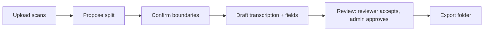
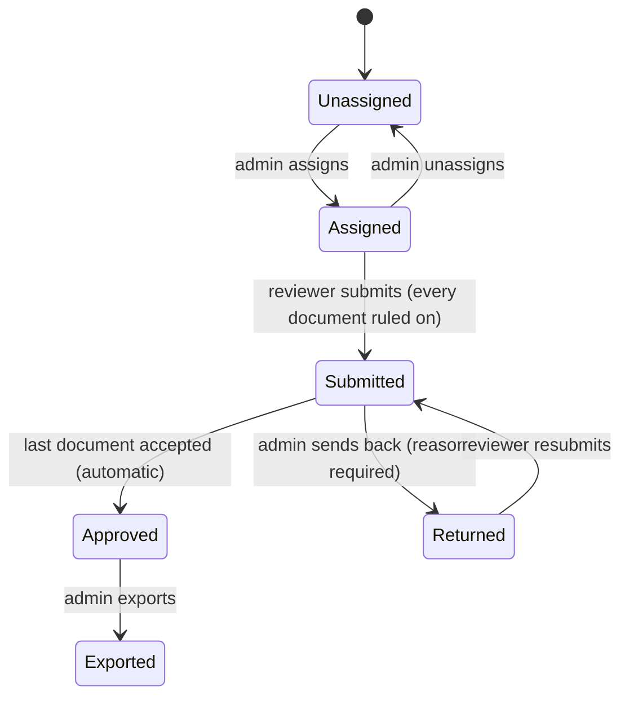

# Incipit

A transcription, indexing and review workbench for scanned documents. A folder of scans goes in;
a vision model proposes where each document starts, drafts its transcription and catalogue fields;
reviewers correct and accept; an admin approves; the folder leaves as a CSV, one JSON record per
document, and the images. Nothing reaches the archive that a person has not read.



## The review lifecycle

A folder belongs to one person at a time, and the card always says who.



- **Verdicts are per role.** A reviewer's accept and an admin's review are recorded separately.
- **Progress is computed, never stored.** Counts come from the documents on every request.
- **Approval follows the documents.** Accepting the last one approves the folder; sending one back
  withdraws that approval.

## Setup

```powershell
py -3.12 -m venv .venv
.venv/Scripts/pip install -r requirements.txt
Copy-Item .env.example .env       # then set OPENROUTER_API_KEY
```

## Run the review site

```powershell
.venv/Scripts/python -m incipit.cli review --db data/incipit.db --bucket-uri file://./data/bucket --host 127.0.0.1 --port 8011
```

A new site starts with `incipit init --db data/incipit.db`, which prints a one-time
`/setup?token=…` link: the first person to open it creates the owner and is walked through naming
the site, its look and its sign-in page, and inviting the team. Administrators and reviewers join
with a join code the owner or an admin makes, or are added in the Team tab.

## Storage

- `data/incipit.db` — SQLite application database.
- `data/bucket/documents/` — confirmed scans; `uploads/` raw batches; `records/` one JSON per
  document; `derived/` cached renderings.
- `data/exports/<workflow>/<folder>/` — ZIP, CSV and per-document JSON and images.

## Tests and smoke

```powershell
.venv/Scripts/python -m pytest -q -p no:randomly -n auto
.venv/Scripts/python scripts/smoke_m2.py
```

Each module's smoke script serves a throwaway site with a fake model and drives it over HTTP as
owner, admin and reviewer, printing PASS or FAIL per step.

## Roadmap

Modules are specified in `docs/specs/`: identity foundations, owner and accounts, versioned prompt
profiles with index styles, data-driven tabs, model backends with a spend ledger and recoverable
jobs, S3 storage and restore, packaging, a private hub pilot, then public signup and the landing
page. See `ARCHITECTURE.md` for module ownership.
